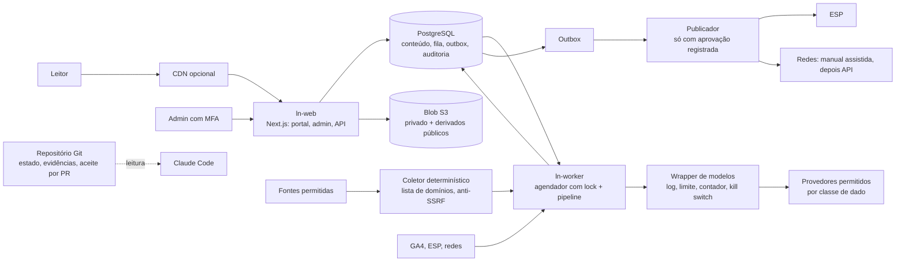

# 03 · Opções de arquitetura, organização, reuniões e MVP

Auditoria independente pré-T00 · 21/11/2026 · nada aqui está aprovado nem implementado.

> **Atualização de 21/11/2026, 19:20.** O responsável decidiu pelo OpenBot como runtime (M1), pelos 64 perfis e 28 rituais ativos desde o início (M2), por Redis e BullMQ (M4), pelo gateway completo (M6), pela publicação social autônoma via mLabs (M7) e pelo comercial completo (M11). As matrizes registram a recomendação da auditoria; as seções 2, 5, 6 e 8 descrevem a alternativa enxuta, que não será adotada. Vale `11_CONCILIACAO.md`. Continuam em uso: a seção 3 (testes do OpenBot, agora de prontidão), a seção 4 (perguntas à Vertra), a seção 7 e as ADRs, a rever na tarefa R0-08.

Identificadores: D01–D19 são as linhas do registro de decisões do dossiê; M1–M11 são as matrizes desta auditoria; DH-01–DH-19 são as decisões humanas pendentes (`07_DECISIONS_REQUIRED.md`); CP-01 em diante são as propostas de mudança (`08_CHANGE_PROPOSALS.md`).

Como ler: cada afirmação sobre produto de terceiro traz o identificador da fonte (S01…S35, em `09_SOURCES.md`). Cada achado citado (F-0xx) está em `02_FINDINGS.csv`. As notas de 1 a 5 são julgamento da auditoria; a conta é feita por `tools/scorecards.py` e pode ser refeita trocando notas ou pesos.

## 1. Scorecards das decisões

Critérios e pesos do mandato: Q qualidade e credibilidade 25%, S segurança e governança 25%, C custo total 20%, E facilidade de implantação e operação 15%, P escalabilidade e portabilidade 15%. Requisito eliminatório de segurança, legalidade ou integridade vence os pontos; requisito explícito do dono só cai por decisão dele.

### M1 · Runtime de orquestração

| Opção | Q | S | C | E | P | Total (pesos do mandato) | Observação |
|---|:-:|:-:|:-:|:-:|:-:|:-:|---|
| A. OpenBot como runtime (proposta atual) | 3 | 2 | 2 | 2 | 2 | 2,25 | Eliminatório enquanto não houver licença comercial; termos avisam acesso total ao sistema |
| **B. Orquestração própria: fila + workers, perfis sob demanda** | 4 | 4 | 4 | 4 | 4 | **4,00** |  |
| C. Híbrido: própria como autoridade, OpenBot como cabine opcional | 4 | 3 | 3 | 3 | 3 | 3,25 | Só após licença e PoC |

Sensibilidade (vencedora e total com outros pesos) — custo e simplicidade (20/20/30/20/10): B. 4,00; governança e credibilidade (30/35/10/10/15): B. 4,00; escala e portabilidade (20/20/15/10/35): B. 4,00. A vencedora não muda em nenhum dos quatro conjuntos de pesos.
Depende de teste: PoC OpenBot (8 testes) decide se C chega a existir. Premissas: sem API pública documentada (S07, S11); exige VPS com sudo (S09).

### M2 · Desenho organizacional e rituais

| Opção | Q | S | C | E | P | Total (pesos do mandato) | Observação |
|---|:-:|:-:|:-:|:-:|:-:|:-:|---|
| A. 64 perfis e 28 rituais ativos desde o dia 1 (proposta atual) | 3 | 3 | 3 | 1 | 3 | 2,70 |  |
| **B. Enxuto fixo: ~16 perfis, 3 rituais, sem registro de diretorias** | 4 | 4 | 5 | 5 | 2 | **4,05** | Contraria D07 e D08 (requisitos do dono): exige decisão humana |
| C. Ondas: registro completo preservado, ~16 perfis por tarefa parametrizados por redação, rituais ativados por volume | 4 | 4 | 4 | 4 | 4 | 4,00 | Mantém daily, semanal e mensal desde o início, no mínimo |

Sensibilidade (vencedora e total com outros pesos) — custo e simplicidade (20/20/30/20/10): B. 4,30; governança e credibilidade (30/35/10/10/15): C. 4,00; escala e portabilidade (20/20/15/10/35): C. 4,00. **A ordem muda** com: governança e credibilidade (30/35/10/10/15), escala e portabilidade (20/20/15/10/35).
Depende de teste: Medir no piloto: atas lidas por dia e decisões por ata. Premissa: o gargalo é atenção humana, não tokens (04_cost_model).

### M3 · Hospedagem

| Opção | Q | S | C | E | P | Total (pesos do mandato) | Observação |
|---|:-:|:-:|:-:|:-:|:-:|:-:|---|
| **A. Vertra PaaS para web, API, workers, banco e blob (plano de implantação)** | 4 | 3 | 5 | 4 | 3 | **3,80** | Região, PITR e rede privada sem evidência |
| B. VPS Linux único com Docker Compose | 3 | 3 | 4 | 2 | 4 | 3,20 | Operação e correções por conta do dono |
| C. Supabase + Vercel (blueprint 2.0) | 4 | 4 | 3 | 4 | 3 | 3,65 | Contraria D10 (requisito do dono) |

Sensibilidade (vencedora e total com outros pesos) — custo e simplicidade (20/20/30/20/10): A. 4,00; governança e credibilidade (30/35/10/10/15): C. 3,75; escala e portabilidade (20/20/15/10/35): A. 3,60. **A ordem muda** com: governança e credibilidade (30/35/10/10/15).
Depende de teste: Respostas de T00-03 podem inverter A e C no critério segurança. Premissa: preços de tabela Vertra (S15); os de Supabase e Vercel não foram verificados.

### M4 · Fila e estado durável

| Opção | Q | S | C | E | P | Total (pesos do mandato) | Observação |
|---|:-:|:-:|:-:|:-:|:-:|:-:|---|
| A. Redis + BullMQ (plano de implantação) | 4 | 3 | 4 | 3 | 4 | 3,60 | Persistência do Redis na Vertra não documentada |
| **B. Fila em PostgreSQL com outbox na mesma transação** | 4 | 4 | 5 | 4 | 3 | **4,05** |  |
| C. Fila gerenciada de terceiro | 4 | 4 | 3 | 2 | 4 | 3,50 | Mais uma conta e um operador de dados |

Sensibilidade (vencedora e total com outros pesos) — custo e simplicidade (20/20/30/20/10): B. 4,20; governança e credibilidade (30/35/10/10/15): B. 3,95; escala e portabilidade (20/20/15/10/35): B. 3,80. A vencedora não muda em nenhum dos quatro conjuntos de pesos.
Depende de teste: Teste de carga em T01: se a fila em SQL não sustentar o volume, adotar A. Premissa: centenas de jobs por dia no MVP.

### M5 · Roteamento de modelos

| Opção | Q | S | C | E | P | Total (pesos do mandato) | Observação |
|---|:-:|:-:|:-:|:-:|:-:|:-:|---|
| A. Contrato atual: DeepSeek na base, Opus/Fable no topo, rota por cargo | 3 | 2 | 4 | 3 | 3 | 2,95 | Sem classe de dado; fallback sobe de preço |
| B. Provedor único (Haiku, Sonnet, Opus, com lote) | 4 | 4 | 3 | 5 | 2 | 3,65 | Sem verificação cruzada entre provedores |
| **C. Por tarefa e classe de dado, dois provedores permitidos, decidido por eval** | 4 | 4 | 4 | 3 | 4 | **3,85** |  |

Sensibilidade (vencedora e total com outros pesos) — custo e simplicidade (20/20/30/20/10): C. 3,80; governança e credibilidade (30/35/10/10/15): C. 3,90; escala e portabilidade (20/20/15/10/35): C. 3,90. A vencedora não muda em nenhum dos quatro conjuntos de pesos.
Depende de teste: Golden set em português decide os modelos; tabela de preço não decide. Premissa: tarifas verificadas (S01, S02); qualidade não medida.

### M6 · Gateway de modelos

| Opção | Q | S | C | E | P | Total (pesos do mandato) | Observação |
|---|:-:|:-:|:-:|:-:|:-:|:-:|---|
| A. Gateway próprio completo: catálogo, reserva atômica, ledger, canário (proposta atual) | 4 | 4 | 2 | 1 | 4 | 3,15 |  |
| **B. Wrapper fino: log por chamada, limite por execução, contador diário, kill switch** | 3 | 4 | 5 | 5 | 3 | **3,95** |  |
| C. Gateway gerenciado de terceiro | 3 | 3 | 3 | 4 | 3 | 3,15 | Não verificado; acrescenta operador no caminho dos dados |

Sensibilidade (vencedora e total com outros pesos) — custo e simplicidade (20/20/30/20/10): B. 4,20; governança e credibilidade (30/35/10/10/15): B. 3,75; escala e portabilidade (20/20/15/10/35): B. 3,70. A vencedora não muda em nenhum dos quatro conjuntos de pesos.
Depende de teste: Reavaliar quando o gasto mensal passar de US$ 100 ou houver mais de um ambiente pagante. Premissa: gasto de API de dezenas de dólares por mês.

### M7 · Publicação social

| Opção | Q | S | C | E | P | Total (pesos do mandato) | Observação |
|---|:-:|:-:|:-:|:-:|:-:|:-:|---|
| A. Postiz acionado pelo OpenBot (proposta atual) | 3 | 2 | 3 | 2 | 3 | 2,60 | Plugin pode publicar na hora |
| B. APIs oficiais diretas desde o início | 4 | 4 | 4 | 2 | 4 | 3,70 | LinkedIn exige pessoa jurídica, site e análise |
| **C. Manual assistida por 60–90 dias, depois API ou agendador** | 4 | 5 | 5 | 5 | 2 | **4,30** |  |

Sensibilidade (vencedora e total com outros pesos) — custo e simplicidade (20/20/30/20/10): C. 4,50; governança e credibilidade (30/35/10/10/15): C. 4,25; escala e portabilidade (20/20/15/10/35): B. 3,80. **A ordem muda** com: escala e portabilidade (20/20/15/10/35).
Depende de teste: PoC de menções e de recibo antes de automatizar. Premissa: 2 a 5 posts por dia.

### M8 · Base de entidades

| Opção | Q | S | C | E | P | Total (pesos do mandato) | Observação |
|---|:-:|:-:|:-:|:-:|:-:|:-:|---|
| **A. PostgreSQL relacional com vigência temporal** | 4 | 4 | 5 | 5 | 3 | **4,20** |  |
| B. Banco de grafo dedicado | 4 | 3 | 2 | 2 | 4 | 3,05 |  |
| C. PostgreSQL + exportação de leitura para ferramenta de grafo | 4 | 4 | 4 | 3 | 4 | 3,85 |  |

Sensibilidade (vencedora e total com outros pesos) — custo e simplicidade (20/20/30/20/10): A. 4,40; governança e credibilidade (30/35/10/10/15): A. 4,05; escala e portabilidade (20/20/15/10/35): A. 3,90. A vencedora não muda em nenhum dos quatro conjuntos de pesos.
Depende de teste: Migrar só se consulta de caminho com mais de 3 saltos passar do limite de latência acordado. Premissa: até centenas de milhares de arestas.

### M9 · Ferramenta de governança para o Claude Code

| Opção | Q | S | C | E | P | Total (pesos do mandato) | Observação |
|---|:-:|:-:|:-:|:-:|:-:|:-:|---|
| A. Servidor MCP remoto próprio com banco (intenção de D12) | 4 | 3 | 2 | 2 | 4 | 3,05 |  |
| B. Só arquivos versionados + CLI | 3 | 4 | 5 | 5 | 3 | 3,95 |  |
| **C. Arquivos + CLI + MCP local de leitura; escrita por PR; aceite humano no GitHub** | 4 | 5 | 4 | 4 | 4 | **4,25** |  |

Sensibilidade (vencedora e total com outros pesos) — custo e simplicidade (20/20/30/20/10): B. 4,20; governança e credibilidade (30/35/10/10/15): C. 4,35; escala e portabilidade (20/20/15/10/35): C. 4,20. **A ordem muda** com: custo e simplicidade (20/20/30/20/10).
Depende de teste: Nenhum. Requisito eliminatório: o agente não pode registrar aceite.

### M10 · Transparência sobre automação editorial

| Opção | Q | S | C | E | P | Total (pesos do mandato) | Observação |
|---|:-:|:-:|:-:|:-:|:-:|:-:|---|
| A. Nunca informar (pedido original do dono) | 2 | 2 | 5 | 5 | 3 | 3,20 | Vira eliminatório se norma ou contrato exigir informação |
| **B. Página institucional de metodologia; assinatura 'Redação Loyalty News'** | 4 | 4 | 5 | 5 | 4 | **4,35** |  |
| C. Selo em cada matéria | 4 | 5 | 4 | 4 | 4 | 4,25 |  |

Sensibilidade (vencedora e total com outros pesos) — custo e simplicidade (20/20/30/20/10): B. 4,50; governança e credibilidade (30/35/10/10/15): C. 4,35; escala e portabilidade (20/20/15/10/35): B. 4,25. **A ordem muda** com: governança e credibilidade (30/35/10/10/15).
Depende de teste: Nenhum; é escolha do dono com revisão jurídica. Premissa: nicho B2B pequeno, em que reputação pesa mais que alcance.

### M11 · Lançamento comercial

| Opção | Q | S | C | E | P | Total (pesos do mandato) | Observação |
|---|:-:|:-:|:-:|:-:|:-:|:-:|---|
| A. 47 formatos e tabela de benchmark no lançamento (proposta atual) | 2 | 3 | 2 | 1 | 3 | 2,25 | 22 formatos sem operação |
| B. Só banners e newsletter, a preço de tabela | 3 | 4 | 4 | 4 | 3 | 3,60 |  |
| **C. Cotas fundadoras + 6–8 formatos ativos; o resto 'sob consulta'** | 4 | 4 | 4 | 4 | 4 | **4,00** |  |

Sensibilidade (vencedora e total com outros pesos) — custo e simplicidade (20/20/30/20/10): C. 4,00; governança e credibilidade (30/35/10/10/15): C. 4,00; escala e portabilidade (20/20/15/10/35): C. 4,00. A vencedora não muda em nenhum dos quatro conjuntos de pesos.
Depende de teste: Conversa com 5 anunciantes potenciais antes de fixar preço. Premissa: audiência inicial zero.

Leitura dos resultados:

- **M2 é o caso em que os pontos não decidem.** O modelo enxuto fixo vence por 0,05, mas apaga redações e diretorias (D07 do registro de decisões) e reuniões entre agentes desde o início (D08), que são requisitos do dono. A recomendação é a opção C, em ondas, salvo decisão do dono em contrário.
- **M3 depende de teste.** A Vertra vence pelos pesos do mandato; com peso maior em governança, Supabase + Vercel passam à frente por causa do que a Vertra ainda não evidenciou (região, recuperação a um ponto no tempo, rede privada). As respostas de T00-03 fecham a questão.
- **M10 depende do peso dado à governança.** Página de metodologia vence nos pesos do mandato; selo por matéria vence quando governança pesa mais. É escolha do dono.
- M1, M4, M5, M6, M8 e M11 têm a mesma vencedora nos quatro conjuntos de pesos.

## 2. Arquitetura mínima proposta

O que muda em relação ao plano de implantação: dois serviços em vez de seis (`ln-web` e `ln-worker`; o renderizador entra no worker se dispensar navegador), fila e outbox no PostgreSQL em vez de Redis, wrapper fino em vez de gateway completo, e OpenBot fora do desenho até passar por PoC. Nenhum requisito funcional sai; o que muda é quantas peças precisam existir no primeiro dia.

Dimensionamento e custo (preços de tabela S15; memória por serviço é **premissa** a medir em T01):

| Cenário | Produção | Homologação | Plano | R$/mês |
|---|---|---|---|---:|
| Enxuto | web 1 GB, worker 1 GB, PostgreSQL 1,5 GB | metade, no mesmo plano | Pro 8 | 47,90 |
| Base | web 2 GB, worker 2 GB, renderizador 2 GB, PostgreSQL 3 GB | plano separado | Business 12 + Pro 4 | 80,80 |
| Alto | web 4 GB, worker 4 GB, renderizador 3 GB, PostgreSQL 6 GB, Redis 1 GB | plano separado | Business 24 + Pro 8 | 187,80 |

Continuidade, isolamento e segredos:

- **RPO/RTO.** A plataforma faz backup diário de banco a partir do Pro 4 (S15). Proposta: `pg_dump` cifrado a cada 6 horas para destino fora da Vertra, ensaio de restauração em T01 e só então fixar números. Alvo a comprovar: RPO de 6 horas, RTO de 4 horas.
- **Homologação e produção.** Bancos, apps, chaves e domínios separados; no cenário base, planos separados. Teste negativo obrigatório: credencial de homologação não lê produção.
- **Rollback.** Versão anterior da aplicação pela plataforma (S13, S17); migração de banco em duas etapas (expandir, depois contrair); chaves de recurso por canal: portal, newsletter, social, coleta.
- **Segredos e MFA.** A plataforma não distingue variável de segredo (S17): restringir membros do workspace, usar chaves de API com escopo mínimo (S14), papéis de banco por serviço (leitura pública, escrita do admin, worker, migração) e MFA obrigatório no admin. Nenhum segredo em chat, log ou prompt.
- **PostgreSQL gerenciado ou próprio.** Gerenciado, na Vertra: backup diário, TLS com certificado de cliente e métricas já vêm com o serviço (S15, S16). Um PostgreSQL próprio em VPS só se justifica se faltar extensão indispensável ou recuperação a um ponto no tempo.
- **CI/CD e observabilidade.** CI com lint, tipos, testes, varredura de segredos e deploy automático só em homologação; produção por aprovação humana. Observabilidade mínima: logs e métricas da plataforma (S17), rastreio de erros na aplicação, verificação externa de disponibilidade e alerta de fila parada. A retenção de logs da plataforma não está documentada: exportar o que a auditoria precisar.

Supabase e Vercel: remover do MVP, como pede o requisito D10 do registro de decisões. Para a troca não custar caro depois, usar SQL padrão e não depender de função específica de fornecedor. Voltar a considerar se T00-03 mostrar que a Vertra não atende a requisito de segurança (matriz M3).

## 3. OpenBot: avaliação, comparação e PoC

Fatos: uso comercial exige licença paga (S07, S08); o guia de instalação pede Ubuntu 24.04 com sudo, ou Docker Compose com perfil seccomp próprio (S09); a Vertra é PaaS sem SSH, com app rodando como usuário 1000 (S12, S13); não há API pública documentada para acionar agentes de fora, mas há rotinas por webhook, gatilhos agendados e cliente MCP (S11); versão 0.75, com mudança de formato de dados que impede abrir os dados em versão anterior (S11); os termos avisam que agentes podem operar com acesso total ao sistema (S08).

| | OpenBot como runtime | Orquestração própria | Híbrido |
|---|---|---|---|
| Quem guarda estado e orçamento | OpenBot | PostgreSQL do projeto | PostgreSQL do projeto |
| Idempotência, lease, DLQ, replay | A comprovar | Sob controle do projeto | Sob controle do projeto |
| Recuperação após restart | A comprovar; rollback de versão não é seguro (S09) | Testável em T02 | Testável em T02 |
| Permissão por perfil | Níveis de acesso do app | Papel de banco + lista de ferramentas | As duas |
| Hospedagem | VPS externo ou servidor hospedado do fornecedor | Vertra | Vertra + VPS externo |
| Licença | Comercial paga | Nenhuma | Comercial paga |
| Portabilidade | Formato próprio | Contratos JSON do projeto | Contratos JSON do projeto |

Recomendação: **orquestração própria como autoridade**. O OpenBot fica como experimento opcional, fora do caminho crítico. O registro `agents.registry.json` continua sendo contrato lógico, como o próprio blueprint diz.

PoC verificável, se o dono quiser manter a opção. Só em VPS externo isolado, sem credencial de produção, depois de obter a licença:

| # | Teste | Passa se |
|---|---|---|
| 1 | Licença | Contrato comercial lido e aceito pelo dono; preço registrado |
| 2 | Disparo externo | Um webhook assinado inicia uma execução e a mesma chave enviada duas vezes não gera duas execuções |
| 3 | Retorno estruturado | A execução devolve JSON válido contra o esquema do projeto, com identificador de execução |
| 4 | Persistência | Após reiniciar o processo e a máquina, execuções em curso terminam uma única vez |
| 5 | Isolamento | Agente com acesso "só workspace" não lê arquivo fora dele nem variável de ambiente do host |
| 6 | Modelo por tarefa | A execução usa o modelo pedido pelo projeto e reporta tokens de entrada e saída |
| 7 | Concorrência | Vinte execuções simultâneas sem perda, duplicação ou travamento |
| 8 | Atualização e volta | Atualizar a versão e restaurar o backup anterior em menos de 30 minutos, com dados íntegros |

Critérios de abandono: qualquer falha em 1, 2, 4 ou 5; mais de cinco dias úteis de PoC; ou custo total mensal (licença + VPS) acima do orçamento que o dono fixar.

## 4. Vertra: o que está evidenciado e o que perguntar em T00-03

Evidenciado em documentação pública: PaaS com contêiner isolado; PostgreSQL 17/18 e Redis com TLS e certificado de cliente; blob compatível com S3; imagens Docker por Dockerfile; disco persistente em `/app`; backups diários por plano; chaves de API com escopo; preços (S12–S17).

Não evidenciado, a responder em T00-03, somente leitura:

1. Em que país e datacenter ficam aplicações, bancos e blob? O host de banco contém `usa1`.
2. Existe rede privada entre aplicação e banco, ou todo tráfego usa o host público com certificado?
3. Qual a retenção dos backups diários e dos snapshots? Há recuperação a um ponto no tempo?
4. O Redis persiste em disco? Qual a política de descarte quando a memória acaba?
5. Qual a capacidade livre do plano já contratado e quais aplicações existentes não podem ser tocadas?
6. É possível separar homologação e produção em workspaces com membros e chaves distintos?
7. Um contêiner sem root consegue rodar Chromium (sandbox, memória compartilhada)?
8. Há verificação de saúde e troca de versão sem indisponibilidade?
9. Por quanto tempo os logs ficam disponíveis e como exportá-los?
10. Quais escopos de chave de API cobrem o inventário sem permitir escrita?
11. Há limite de saída de rede ou de conexões simultâneas ao banco?
12. Como é o processo de restauração de um snapshot de banco em outra instância, e quanto tempo leva?

## 5. Desenho organizacional

Três desenhos comparados (matriz M2):

| | Completo (atual) | Enxuto fixo | Ondas (recomendado) |
|---|---|---|---|
| Perfis executáveis | 64 | ~16 | ~16 por tarefa, parametrizados |
| Redações | 20 perfis | não existem | 10 configurações (fontes, glossário, estilo, memória) aplicadas a 2 perfis |
| Diretorias | 8 perfis com rota premium | não existem | visão de organograma e dono de ritual; decisão protegida é humana |
| Rituais ativos no início | 28 | 3 | 3 (um diário, um semanal, um mensal); os outros 25 por critério |
| Requisitos D07 e D08 | atende | não atende | atende |

Perfis persistentes ou sob demanda: **sob demanda**. O blueprint já diz que não há 64 processos residentes; a auditoria propõe ir um passo além e tratar perfil como configuração de uma chamada (prompt versionado + ferramentas + esquema de saída), sem processo, sessão ou workspace próprios. Memória de trabalho fica no banco, por redação e por matéria, não no agente.

Perfis por tarefa propostos e de onde vêm:

| Perfil por tarefa | Absorve do registro de 64 | Ferramentas | Saída |
|---|---|---|---|
| `triage` | newsdesk | ler item coletado | editoria, score, duplicata provável |
| `desk_writer(redação)` | writer_* (10) | ler pacote de evidências | rascunho estruturado com claims |
| `desk_editor(redação)` | editor_* (10) | ler rascunho e evidências | parecer, ajustes, risco |
| `fact_checker` | factcheck | ler claims e evidências | mapa claim → evidência, bloqueios |
| `rights_checker` | rights, media | ler registro de licenças | aprovado, bloqueado, motivo |
| `chief_editor_synth` | editorial | ler digest do dia | prioridades, conflitos |
| `seo_meta` | seo | ler matéria aprovada | título, descrição, slug, dados estruturados |
| `social_copy(canal)` | linkedin, instagram, social | ler matéria publicada e entidades | texto por canal, texto alternativo |
| `visual_qa` | visualqa | ler arte e matéria | conforme ou não, motivo |
| `newsletter_editor` | newsletter | ler matérias do período | edição com blocos |
| `entity_extractor` | discovery, people, company | ler matéria publicada | entidades candidatas com evidência |
| `entity_resolver` | graph, orgchart, moves | ler candidatas e base | vínculo, conflito, pendência |
| `data_qa` | dataqa, audit | ler amostra | achados de qualidade |
| `commercial_assistant` | sales, pricing, account | ler lead e catálogo | rascunho de proposta ou relatório |
| `ops_digest` | finops, sre, growth_analytics, marketdata | ler métricas | resumo e alertas |
| `meeting_chair(ritual)` | publisher e os 7 diretores | ler snapshot e contribuições | ata, decisões propostas |

Viram serviço determinístico, sem modelo: designer (renderizador), publisher_social (publicador), adops (reserva e rotação), coleta, deduplicação, agendador. Ficam como processo humano ou de engenharia, não como agente de runtime: platform, security, privacy. Ficam para onda posterior, desativados: agenda, talks, community, image.

Redundâncias, laços e decisões sem dono encontrados: WF12 duplica WF15 para uma reunião e não corresponde a nenhuma das duas reuniões semanais (F-032); interdiretorias e board mensal têm os mesmos participantes; tarefas atrasadas voltam às reuniões sem limite (F-038); nove papéis humanos decidem sem existir em registro (F-022); onze perfis não têm processo (F-021).

Filas, comunicação e contratos: uma fila por tipo de trabalho (coleta, redação, checagem, social, entidades, métricas, reuniões), mensagens como eventos com chave de idempotência, e nenhum agente falando com outro fora de evento registrado. Cada perfil tem esquema JSON de entrada e de saída, validado antes de seguir.

## 6. Reuniões

Custo (modelo em `04_cost_model.csv`; tarifas verificadas, tokens são premissa):

| | Chamadas por dia útil | US$ por dia útil | US$ por mês |
|---|---:|---:|---:|
| Registro atual, cenário enxuto | 95 | 0,11 | 3,45 |
| Registro atual, cenário base | 128 | 0,28 | 8,73 |
| Registro atual, cenário alto | 152 | 0,68 | 22,20 |
| Dia sem novidades, sem regra de silêncio | 95 | 0,07 | 1,45 se todos os dias |
| Dia sem novidades, com regra de silêncio | 0 | 0 | 0 |
| Alternativa enxuta (onda inicial) | 4 | 0,03 | 1,44 |

O dinheiro é pequeno em qualquer linha. O que pesa é o resto: 18 atas por dia, cada uma podendo abrir tarefas e pedir decisão humana.

Proposta em ondas, mantendo os 28 modelos no registro:

| Onda | Ativos | Critério para ativar a próxima |
|---|---|---|
| Início | Digest determinístico diário (SQL, sem modelo) + síntese editorial diária; conselho semanal único; board mensal com o dono | 30 dias corridos de operação e mais de 6 matérias publicadas por dia útil |
| Redações | Daily de redação só nas que tiverem itens novos no dia (regra de silêncio) | Mais de 3 redações com itens em 15 de 20 dias úteis |
| Diretorias | Dailies de Growth, Intelligence e Trust quando os respectivos produtos estiverem em produção | Canal ou produto correspondente no ar |
| Completo | Os 28 | Decisão do dono com base em atas lidas e decisões aproveitadas |

Regras de contrato a acrescentar: quórum numérico por ritual; ausência do chair (substituto nomeado ou cancelamento); duas rodadas no máximo, já previsto; ata sempre; tarefa criada só de decisão validada; decisão protegida só com aprovação humana em canal separado; calendário de feriados; o mensal substitui o semanal da mesma semana; horário fora da janela de pico do provedor (F-033); a The Loyal nunca espera reunião do mesmo dia.

## 7. Base de entidades: quando migrar para grafo

Ficar em PostgreSQL enquanto as quatro condições valerem: até cerca de um milhão de relações; consultas de caminho com no máximo três saltos; latência no percentil 95 dentro do limite combinado para a tela; nenhum algoritmo de grafo (centralidade, comunidades) em requisito de produto. Se duas delas deixarem de valer por 30 dias, abrir ADR de migração. Extensão de grafo dentro do PostgreSQL não é opção na Vertra, que não aceita extensões de terceiros (S16).

## 8. MVP proposto em três ondas

Nada do escopo original é descartado: o que não entra numa onda fica no backlog como "indisponível" até decisão do dono.

| | Onda R1 · Presença e validação | Onda R2 · Redação assistida | Onda R3 · Distribuição e receita |
|---|---|---|---|
| Público | Página de pré-lançamento, política de privacidade, inscrição na The Loyal com confirmação | Portal com home, editorias, matéria, busca, Em alta, Últimas, agenda simples, rodapé | Mídia kit com métricas reais ou "não disponível" |
| Editorial | Edições manuais curtas para testar interesse | Coleta de fontes primárias, triagem, redação, checagem, direitos, aprovação humana; duas redações piloto e depois dez | Correções, direito de resposta, metodologia pública |
| Social | Página do LinkedIn criada; posts manuais | Pacote social gerado e aprovado; publicação manual assistida | API ou agendador após PoC |
| Intelligence | — | Entidades do tipo organização marcadas nas matérias | Páginas de organização; pessoas só após F-090 |
| Comercial | Conversa com cinco anunciantes potenciais | Espaços reservados na página, sem venda | Cotas fundadoras e 6–8 formatos ativos |
| Agentes e rituais | — | ~16 perfis por tarefa; digest e síntese diários | Rituais por critério de volume |

Depois do lançamento, por decisão do dono: The Loyal diária, Instagram, organogramas e Moves, planos pagos, Talks, Jobs, autonomia por classe de risco, os demais formatos comerciais.

## 9. ADRs propostas (nenhuma aprovada)

| ADR | Decisão proposta | Depende de |
|---|---|---|
| ADR-001 | Pilha: Next.js, PostgreSQL, blob S3 na Vertra; sem Supabase e sem Vercel no MVP | T00-03 |
| ADR-002 | Orquestração própria com fila e outbox em PostgreSQL; Redis só se o teste de carga pedir | Teste em T01 |
| ADR-003 | OpenBot fora do caminho crítico; PoC opcional com critérios de abandono | Decisão do dono, licença |
| ADR-004 | Perfis por tarefa sob demanda; registro de 64 preservado como organograma e configuração | Decisão do dono |
| ADR-005 | Rituais em ondas com regra de silêncio; 28 modelos preservados | Decisão do dono |
| ADR-006 | Wrapper de modelos com classes de dado e provedores permitidos; teto de piloto | Evals, parecer jurídico |
| ADR-007 | Coletor determinístico separado dos modelos; modelos sem ferramenta de rede | — |
| ADR-008 | Publicação só pelo serviço próprio com aprovação registrada; social manual assistida no início | PoC de APIs |
| ADR-009 | Entidades em PostgreSQL; pessoas só após base legal registrada | Parecer jurídico |
| ADR-010 | Governança em arquivos versionados + CLI + MCP local de leitura; aceite por PR humano | — |
| ADR-011 | Autenticação do admin: comparar três opções; MFA obrigatório; sem cadastro público | — |
| ADR-012 | Backup: `pg_dump` cifrado a cada 6 h para destino externo; ensaio de restauração antes de fixar RPO/RTO | T00-03 |
