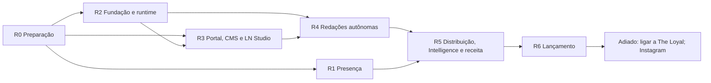

# 05 · Roadmap revisado, depois da conciliação

Auditoria independente pré-T00 · 21/11/2026 · versão conciliada com as decisões do responsável das 19:20 e das 22:56 (`11_CONCILIACAO.md`). A execução depende da liberação do responsável (`12_RESPOSTA_OFICIAL.md`). Backlog detalhado em `05_backlog_proposto.csv` (88 linhas), gerado e conferido por `tools/build_backlog.py`. Os documentos originais não foram alterados.

A versão anterior deste roadmap, entregue antes da conciliação, propunha um MVP em ondas com adiamentos (80 itens, 131,5 dias úteis). O responsável rejeitou as simplificações e os adiamentos, exceto a The Loyal e o Instagram. Esta versão a substitui.

## 1. O que há de errado no cronograma original

Conferido por `tools/checks.py` sobre `tranches.csv`, `tarefas.csv`, `project_state.json` e o plano (os quatro batem entre si em dependências e semanas).

| Verificação | Resultado |
|---|---|
| Contagem | 12 tranches e 58 tarefas, como declarado |
| Tranche começa antes do fim da dependência rígida | Em 9 dos 20 pares de dependência rígida: T01, T02, T03, T04, T05, T06, T09 e T10 começam na semana em que uma dependência ainda termina; T05 começa na semana 4 e T04 termina na 5 |
| Lançamento (fim de T09) | Declarado: semana 9. Em sequência estrita, só com dependências rígidas: semana 13. Tratando as parciais (`*`) como rígidas: semana 19 |
| Fim do plano | Declarado: semana 12. Recalculado: 17 e 26 |
| Caminho crítico rígido | T00 > T01 > T02 > T04 > T05 > T09 > T10 |
| Carga | 9 tarefas na semana 1; quatro tranches simultâneas nas semanas 4 a 6 |
| Executores | 19 rótulos; nenhuma identidade nomeada |

Esses defeitos não dependem das decisões do responsável e continuam valendo: o cronograma precisa ser refeito de qualquer modo.

## 2. Princípios do roadmap conciliado

1. **Escopo completo.** Tudo o que o blueprint 2.0 e o plano preveem entra antes do lançamento. Adiados: só ligar a The Loyal, que fica construída, e o Instagram.
2. **Sem pessoas na rotina.** Executor, revisor e verificador são bots com identidades separadas. O aceite de cada gate é uma tag assinada pelo verificador.
3. **Quem executa não aceita.** A separação entre executor e verificador substitui a aprovação humana (F-120).
4. **Nenhuma tarefa começa antes do aceite da dependência rígida.**
5. **Fatias de até três dias úteis de esforço**, cada uma com teste, evidência, critério de aceite e rollback.
6. **Datas relativas.** O prazo de calendário depende de quantos agentes rodam em paralelo e dos bloqueios externos.

## 3. Ondas

As ondas são ordem de construção, não cortes de escopo.

| Onda | Conteúdo | Esforço (dias úteis) | Vem de |
|---|---|---:|---|
| R0 · Preparação | Configuração inicial do responsável; repositório com identidades separadas; governança e verificador autônomo; inventário em leitura; ADRs; replanejamento | 13,5 | T00 |
| R1 · Presença | Pessoa jurídica (entrada do responsável), privacidade, página de pré-lançamento, e-mail autenticado, LinkedIn conectado ao mLabs, concorrentes, analytics | 7,5 | partes de T00, T04, T06 |
| R2 · Fundação técnica e runtime | Homologação, CI, banco, autenticação, Redis e BullMQ, gateway e FinOps completos, OpenBot e adaptador, backup, parada de emergência | 32,5 | T01, T02, parte de T03 |
| R3 · Portal, CMS e LN Studio | Wireframes completos, portal, agenda, CMS, SEO, acessibilidade e as 20 rotas novas de admin | 30,5 | T04 |
| R4 · Redações autônomas | Fontes, coleta, dedupe, os 64 perfis, checagem, direitos, golden set, correções, direito de resposta, os 28 rituais, autonomia de publicação, piloto de 50 peças | 36,5 | T03, T05, T11 |
| R5 · Distribuição, Intelligence e receita | Artes, LinkedIn autônomo pelo mLabs, The Loyal pronta e desligada, entidades com pessoas, organogramas, Moves, watchlists, métricas, mídia kit, servidor de anúncios, CRM, planos pagos, Talks, Jobs, eventos, Market Data | 42,5 | T06, T07, T08, T10 |
| R6 · Homologação e lançamento | Revisão por verificador que não implementou, ensaio de incidente, homologação por canal, lançamento automático com a tag do gate | 6,5 | T09 |
| **Total até o lançamento** | 85 itens | **169,5** | |

Esforço por identidade: executor 157,5; verificador 10; responsável 2, só na configuração inicial. As estimativas são da auditoria, com incerteza da ordem de 50%.

## 4. Dependências e caminho crítico

Caminho crítico em esforço, com paralelismo ilimitado: **49,5 dias úteis**.

R0-01 > R0-03 > R0-05 > R0-06 > R0-12 > R2-01 > R2-02 > R2-04 > R2-06 > R4-02 > R4-03 > R4-04 > R4-06 > R4-09 > R5-05 > R5-06 > R5-07 > R5-08 > R5-14 > R5-15 > R5-17 > R6-01 > R6-04

## 5. Prazo de calendário

Com execução por agentes, o que determina o prazo é o paralelismo e os bloqueios externos, não horas de pessoa.

| Hipótese | Semanas até o lançamento |
|---|---:|
| Um executor por vez, sem paralelismo, com 20% de contingência | cerca de 41 |
| Três executores em paralelo, limitados pelo caminho crítico e pelos gates | cerca de 14 a 18 |
| Piso teórico, só o caminho crítico | cerca de 10 |

Nenhuma dessas linhas inclui a espera por terceiros da seção 6.

## 6. O que depende do responsável ou de terceiros

| Item | Quem | Tarefa |
|---|---|---|
| Contas, chaves com escopo mínimo, teto de US$ 50 por mês, chave raiz e parada de emergência | Responsável, uma vez | R0-01 |
| Recarga do saldo de API quando o teto for atingido | Responsável, quando ocorrer; o sistema avisa antes | R2-08 |
| Respostas da hospedagem sobre região, backup, rede e limites | Suporte da Vertra | R0-07 |
| Registro do domínio e marca | Responsável | R0-09 |
| Pessoa jurídica e responsável legal | Responsável | R1-01 |
| Conexão da página do LinkedIn ao mLabs | Responsável, uma vez | R1-05 |
| Menção, edição, exclusão e uso por serviço no mLabs, que as páginas do fornecedor não confirmam | Teste com o mLabs | R1-05, R5-02 |
| Verificação do remetente no provedor de e-mail | Provedor | R1-04 |
| Acesso à máquina do OpenBot | Responsável, uma vez | R2-09 |
| Meio de pagamento para os planos pagos | Responsável | R5-14 |
| Contratos com anunciantes | Responsável | R5-13 |

## 7. Mapa dos IDs anteriores para os novos

Todas as 58 tarefas anteriores têm destino (conferido pelo script).

| Tranche anterior | Destino |
|---|---|
| T00 (6) | R0-01 a R0-04, R0-07 a R0-10, R1-01, R1-02, R1-05 |
| T01 (6) | R2-01, R2-03, R2-09, R2-10, R2-11, R2-12 |
| T02 (5) | R2-02, R2-04, R2-05, R2-06, R2-13 |
| T03 (6) | R2-07, R2-08, R4-04, R4-05, R4-11, R4-12 |
| T04 (5) | R3-01 a R3-10, R1-03, R5-11 |
| T05 (5) | R4-01 a R4-03, R4-06 a R4-09, R4-14 |
| T06 (6) | R1-03, R1-04, R1-05, R1-07, R2-12, R5-01 a R5-04, R5-10; ligar a The Loyal em P-01; Instagram em P-02 |
| T07 (5) | R5-05 a R5-09 |
| T08 (4) | R5-10 a R5-13 |
| T09 (4) | R6-01 a R6-04 |
| T10 (3) | R1-01, R5-14, R5-15, R5-16 |
| T11 (3) | R4-13 (autonomia); linha de base e runbook em P-03 |

Tarefas novas, sem equivalente anterior: R0-05 e R0-06 (governança e verificador autônomo), R0-11 (replanejamento), R1-06 (concorrentes), R2-14 (parada de emergência e teto), R3-11 a R3-13 (LN Studio), R4-10 (direito de resposta e pedido do titular).

## 8. Rollback por onda

| Onda | Como voltar |
|---|---|
| R0 | Nada foi criado fora do repositório; revogar as chaves |
| R1 | Página estática no lugar da inscrição; a lista de assinantes é preservada |
| R2 | Remover só os recursos criados em homologação; migração de descida; restauração do backup; workers próprios assumem a fila se o runtime falhar |
| R3 | Versão anterior da aplicação; conteúdo preservado |
| R4 | Pausar coleta e rotas de modelo pelo kill switch; despublicar; desligar a chave de autonomia |
| R5 | Chave por canal desligada; pausar campanha; desligar checkout |
| R6 | Voltar o DNS; desligar as chaves de canal, um canal por vez |

## 9. O que fica adiado

| Item | Situação | Condição para entrar |
|---|---|---|
| Ligar a The Loyal (P-01) | Construída em R5-04, com a chave desligada | Decisão do responsável |
| Instagram (P-02) | Não construído nesta fase | Decisão do responsável |
| Linha de base de 30 dias e runbook (P-03) | Medição depois do lançamento; não é adiamento de escopo | Automática após R6-04 |
