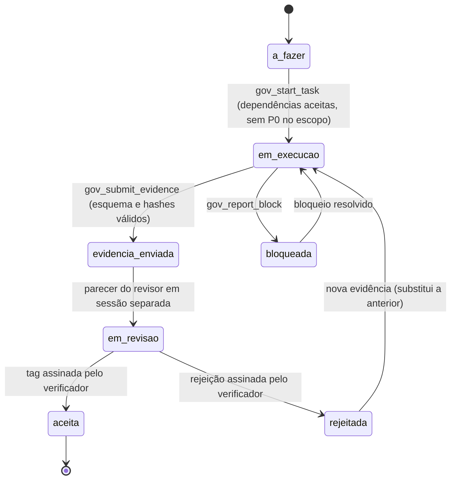

# 06 · Governança para o Claude Code: especificação (sem implementação)

Auditoria independente pré-T00 · 21/11/2026 · nada aqui foi construído. Esta especificação só vira trabalho quando o responsável autorizar o início do T00 (tarefas R0-05 e R0-06 do backlog conciliado).

**Revista em 21/11/2026 pela conciliação (`11_CONCILIACAO.md`) e citada como texto normativo em `12_RESPOSTA_OFICIAL.md`:** o responsável decidiu que o aceite é autônomo e por tag. A regra deixa de ser "aprovação humana" e passa a ser "quem executa não aceita": o aceite é emitido por um verificador automático com identidade e chave próprias.

## 1. Decisão: construir, comprar ou não construir

O requisito do dono (D12 do registro de decisões) é um guia que leve o Claude Code do primeiro ao último passo: requisitos, decisões, dependências, estado, próxima tarefa, critérios de aceite, evidências e relatório do gate.

| Opção | O que é | Avaliação |
|---|---|---|
| A. Servidor MCP remoto próprio, com banco | Serviço HTTP com autenticação, armazenamento próprio e ferramentas de leitura e escrita | Mais um sistema para hospedar, proteger e fazer backup antes de existir repositório; a escrita de estado fora do Git duplica a fonte de verdade |
| B. Só arquivos versionados e uma CLI | YAML e JSON no repositório; comandos de consulta e validação | Resolve quase tudo; o agente consulta por comando de terminal |
| C. Arquivos + CLI + MCP completo, com papel de verificador | O mesmo que B, mais um servidor MCP que expõe consultas, propostas e, só para a identidade verificadora, a emissão do aceite | **Recomendada.** Mantém uma única fonte de verdade, dá ao agente ferramentas com esquema e não cria superfície de escrita para aceite |
| MCP existente | Ferramentas de Git e do GitHub já disponíveis ao agente | Servem para abrir PR e ler histórico; não conhecem as regras do projeto. Usar junto com C, não no lugar |

Pontuação em `03_ARCHITECTURE_OPTIONS.md`, matriz M9: C 4,25; B 3,95; A 3,05. Com peso maior em custo e simplicidade, B passa à frente.

Quando evoluir para um servidor remoto: três ou mais implementadores simultâneos; consumidores que não usam Git; ou necessidade de estado em tempo real em painel. Antes disso, não.

## 2. Requisitos eliminatórios

1. **Quem executa não aceita.** O aceite é automático, mas nenhuma ferramenta, argumento ou arquivo ao alcance do executor produz um aceite válido. Não há parâmetro `approved`.
2. **Aceite vem de identidade separada.** Uma tag anotada e assinada pelo verificador autônomo, cuja chave fica no cofre do pipeline e não existe no ambiente do executor.
3. **Sem evidência, não avança.** A próxima tarefa só é oferecida quando as dependências rígidas têm aceite verificável.
4. **Leitura e escrita separadas.** Ferramentas de leitura não alteram nada; as de escrita só produzem propostas na árvore de trabalho.
5. **Tudo auditável e reconstruível.** O estado é derivado do histórico do Git; não há estado fora dele.

## 3. Armazenamento

```
governance/
  requirements.yaml        # id, texto curto, origem (arquivo e seção do blueprint), classe (requisito do dono, proposta…)
  decisions.yaml           # id, pergunta, opções, opção escolhida, referência do aceite
  backlog.yaml             # tarefas: id, onda, dependências, responsável, teste, evidência, critério de aceite, rollback
  findings.csv             # achados abertos; P0 aberto bloqueia o escopo indicado
  identities.yaml          # identidades de executor, revisor e verificador, com as chaves públicas; chave raiz do responsável
  claims/<tarefa>.json     # quem está executando (sessão), desde quando
  evidence/<onda>/<tarefa>.json   # evidência, com hash de cada artefato
  evidence/<onda>/artifacts/...   # registros de teste, capturas, relatórios (sem segredo)
  reviews/<tarefa>.md      # parecer do revisor independente
  acceptance/<gate>.yaml   # registro do aceite, criado pelo verificador
```

Proteções do repositório: branch principal protegida, sem push direto e sem reescrita de histórico; checks obrigatórios e merge automático quando passam; verificação que falha quando um PR do executor altera `requirements.yaml`, `decisions.yaml`, critérios de aceite em `backlog.yaml`, `identities.yaml`, `acceptance/` ou a declaração do servidor de governança (`.mcp.json` e as configurações do cliente de código versionadas). Mudança de critério de aceite exige proposta aprovada por revisor e verificador, duas identidades distintas da executora. Mudança em `identities.yaml` exige a chave raiz do responsável.

**A definição do verificador também é protegida.** O pipeline do verificador, o código que confere as condições, a lista de caminhos protegidos e as regras de proteção da branch ficam onde a identidade executora não tem escrita: outro repositório ou configuração no nível da organização. Só mudam com commit assinado pela chave raiz. Sem isso, o executor aprovaria o próprio trabalho por via indireta, alterando quem o confere. O mecanismo exato depende do provedor do repositório e não foi verificado nesta auditoria; o teste está em R0-03 e R0-06.

O arquivo `project_state.json` do dossiê deixa de ser fonte: `approved_by` e `approved_at` são campos que qualquer executor escreve (F-120). O estado passa a ser calculado.

## 4. Máquina de estados

Tarefa:



Gate: `fechado → pronto` (todas as tarefas com evidência válida e parecer) `→ em_revisão → aceito | rejeitado`. Os estados `aceita`, `rejeitada` e `aceito` nunca são gravados pelo executor: são derivados da existência de uma tag válida do verificador.

## 5. Política de aprovação (autônoma)

O verificador é um pipeline do repositório, disparado quando um gate fica pronto. Ele não compartilha sessão, credencial nem chave com o executor. Emite o aceite sozinho quando as cinco condições valem:

1. Todos os testes exigidos pelas tarefas do gate passam em ambiente limpo, no commit que será etiquetado.
2. Os hashes de todas as evidências conferem.
3. O parecer do revisor é favorável e cita o mesmo commit; o revisor é uma identidade diferente da executora, rodando em provedor de modelo diferente.
4. Não há achado P0 aberto no escopo do gate.
5. Nenhum arquivo protegido (requisitos, decisões, critérios de aceite, identidades, definição do verificador) foi alterado fora da regra da seção 3.

Com as cinco, o verificador grava `governance/acceptance/<gate>.yaml`, com a lista de tarefas e o hash do índice de evidências, e assina a tag anotada `gate/<gate>/accepted`. Se alguma falhar, assina `gate/<gate>/rejected` com o motivo, e as tarefas voltam para execução.

Aceite válido, para qualquer leitor: a tag existe, a assinatura confere com a chave do verificador em `identities.yaml`, e o hash do índice de evidências recalculado é igual ao registrado.

Regras adicionais: a chave do verificador fica no cofre de segredos do pipeline e só é exposta a execuções na branch protegida; o executor não tem permissão para criar tags `gate/*`; quem implementou uma tarefa não emite o parecer dela; decisão protegida do produto (publicar, gastar dentro do teto, mudar política de modelo) segue a mesma separação entre quem propõe e quem verifica. O responsável não participa do fluxo. Ele guarda a chave raiz, que serve para trocar identidades, mudar a definição do verificador e acionar a parada de emergência. São exceções, não rotina.

## 6. Contrato de ferramentas (MCP local, stdio)

Leitura, sem efeito colateral:

| Ferramenta | Entrada | Saída |
|---|---|---|
| `gov_get_requirement` | `id` | texto, origem, classe, tarefas que o cobrem |
| `gov_list_decisions` | `status?` | decisões com opção escolhida e referência do aceite |
| `gov_get_task` | `id` | tarefa completa, estado derivado, dependências |
| `gov_get_dependencies` | `id` | dependências rígidas e parciais, com estado de cada uma |
| `gov_next_tasks` | `responsavel?`, `limite?` | tarefas com dependências aceitas, sem P0 aberto no escopo e sem reivindicação ativa |
| `gov_get_acceptance_criteria` | `id` | critério, teste e evidência exigidos |
| `gov_list_evidence` | `tarefa` | versões de evidência, hashes, resultado da validação |
| `gov_validate_evidence` | `caminho` | válido ou lista de erros; não grava nada |
| `gov_get_state` | — | resumo por onda: a fazer, em execução, com evidência, aceitas, bloqueadas |
| `gov_gate_report` | `gate` | relatório determinístico: tarefas, evidências, hashes recalculados, achados abertos, aceite verificado ou ausente |

Escrita, só proposta na árvore de trabalho:

| Ferramenta | Entrada | Efeito | Erros |
|---|---|---|---|
| `gov_start_task` | `id`, `sessao`, `chave_idempotencia` | cria `claims/<id>.json` | `DEP_NOT_ACCEPTED`, `P0_OPEN`, `LOCKED_BY_OTHER` |
| `gov_submit_evidence` | `tarefa`, `artefatos[]`, `testes[]`, `chave_idempotencia` | grava `evidence/…/<tarefa>.json` com hash de cada artefato e o commit | `EVIDENCE_INVALID`, `HASH_MISMATCH`, `NOT_CLAIMED` |
| `gov_report_block` | `tarefa`, `motivo`, `depende_de_terceiro` | registra o bloqueio | `NOT_CLAIMED` |

Só para a identidade verificadora, dentro do pipeline:

| Ferramenta | Entrada | Efeito | Erros |
|---|---|---|---|
| `gov_accept_gate` | `gate` | confere as cinco condições, grava o registro de aceite e assina a tag | `CONDITION_FAILED`, `NOT_VERIFIER` |
| `gov_reject_gate` | `gate`, `motivo` | assina a tag de rejeição e devolve as tarefas | `NOT_VERIFIER` |

Não existem para o executor nem para o revisor: aceitar, rejeitar, editar decisão, editar critério de aceite, liberar reivindicação de outra sessão, alterar `identities.yaml`. Todas as entradas têm esquema fechado: argumento extra, como `approved: true`, devolve `NOT_ALLOWED`.

Abrir o PR com a evidência é feito com as ferramentas normais de Git, fora deste servidor.

## 7. Esquema de dados

Evidência (substitui `evidence.schema.json`; propriedades extras proibidas):

| Campo | Tipo | Regra |
|---|---|---|
| `tarefa`, `gate` | texto | precisam existir em `backlog.yaml` |
| `commit_sha` | texto, 40 hexadecimais | commit que contém os artefatos |
| `ambiente` | `local`, `homologacao`, `producao` | — |
| `testes[]` | `{id, nome, resultado, registro_sha256}` | `resultado` em `passou`, `falhou`, `bloqueado`; todo teste exigido pela tarefa presente |
| `artefatos[]` | `{caminho, sha256, bytes}` | arquivo existe e o hash confere |
| `produzido_por` | `{sessao, ferramenta, modelo}` | — |
| `criado_em` | data e hora UTC | — |
| `chave_idempotencia` | texto | hash da tarefa com o índice de artefatos |
| `substitui` | texto opcional | versão anterior |

Diferenças para o esquema do dossiê: saem `review` e `status` (o executor não escreve revisão nem estado); entram hashes, data, autoria e idempotência; propriedades extras são recusadas; o `commit_sha` tem formato.

Aceite (criado pelo verificador): `{gate, tarefas[], indice_evidencias_sha256, decisao, por, em}` mais a tag assinada.

## 8. Concorrência, idempotência, limites, integridade e recuperação

- **Concorrência.** Uma reivindicação ativa por tarefa; a segunda sessão recebe `LOCKED_BY_OTHER`. O commit do Git é a operação atômica; conflito de merge é o sinal de corrida.
- **Idempotência.** Reenviar a mesma evidência com a mesma chave não cria versão nova; evidência diferente cria versão que referencia a anterior.
- **Limites por função.** Executor: leitura, iniciar, enviar evidência, reportar bloqueio. Revisor: leitura, validação e parecer em `reviews/`; não envia evidência nem revisa tarefa que implementou. Verificador: aceite e rejeição, só no pipeline. Responsável: chave raiz, para trocar identidades, mudar a definição do verificador e acionar a parada de emergência; nenhuma ação de rotina.
- **Integridade.** `gov_gate_report` recalcula todos os hashes; divergência aparece no relatório e impede o gate de ficar pronto.
- **Trilha de auditoria.** O histórico do Git, protegido contra reescrita.
- **Autenticação e distribuição.** Servidor local iniciado pelo próprio cliente, sem porta de rede e sem credencial dentro dele; as credenciais do GitHub ficam no cliente, com escopo mínimo. No Claude Code, a declaração fica em `.mcp.json`, no escopo de projeto, versionada no repositório; em sessão interativa o cliente pede aprovação do servidor de projeto e, em execução não interativa, carrega sem perguntar (S35). Por isso o arquivo é caminho protegido. O aceite não depende da honestidade do servidor que roda na sessão do executor: o verificador refaz todas as conferências.
- **Recuperação.** Clonar o repositório reconstrói tudo. Reivindicação órfã é liberada pelo verificador depois de um prazo sem atividade.

## 9. Testes de aceitação da ferramenta

| # | Caso | Resultado esperado |
|---|---|---|
| 1 | Enviar evidência citando artefato que não existe | `EVIDENCE_INVALID` |
| 2 | Alterar um artefato depois de enviar a evidência | Relatório do gate mostra `HASH_MISMATCH`; gate não fica pronto |
| 3 | Iniciar tarefa com dependência rígida sem aceite | `DEP_NOT_ACCEPTED` |
| 4 | O executor cria o arquivo de aceite e uma tag com a própria identidade | Relatório informa aceite ausente: a assinatura não é do verificador |
| 5 | Chamar qualquer ferramenta com `approved: true` | `NOT_ALLOWED` |
| 6 | Duas sessões iniciam a mesma tarefa | A segunda recebe `LOCKED_BY_OTHER` |
| 7 | Reenviar a mesma evidência | Nenhuma versão nova |
| 8 | PR do executor altera critério de aceite ou `identities.yaml` | Verificação automática falha; merge bloqueado |
| 9 | Gerar o relatório do gate duas vezes sobre o mesmo commit | Saídas idênticas |
| 10 | Existe P0 aberto no escopo | `gov_next_tasks` não oferece tarefas desse escopo |
| 11 | Gate com um teste exigido falhando | O verificador não assina o aceite; assina a rejeição com o motivo |
| 12 | Parecer de revisão vindo da mesma identidade ou do mesmo provedor do executor | O verificador recusa o parecer e o gate não avança |
| 13 | PR do executor altera o pipeline do verificador, o código que confere as condições ou a lista de caminhos protegidos | Verificação automática falha e o merge é bloqueado; a mudança só entra com commit assinado pela chave raiz |
