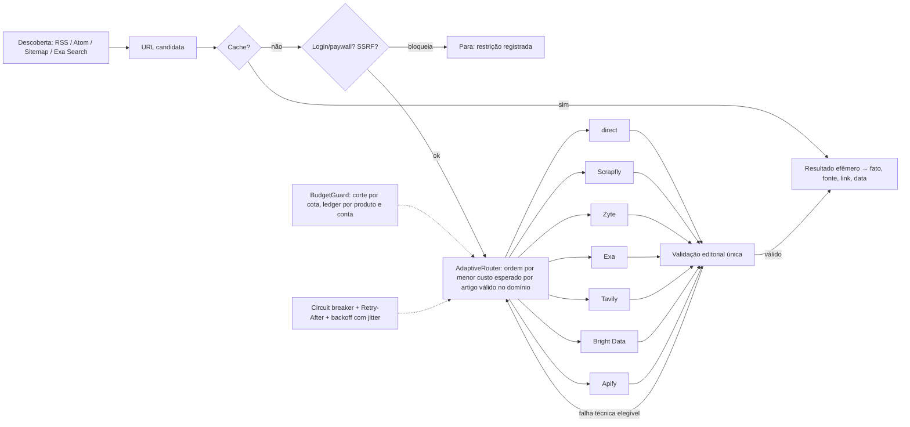

# 01 — Arquitetura

## Módulos (`packages/scraping-benchmark/src`)

| Módulo | Responsabilidade |
|---|---|
| `flags.ts` | `SCRAPING_BENCHMARK_ENABLED`, `SCRAPING_ADAPTIVE_ROUTING_ENABLED`, `SCRAPING_SHADOW_MODE`, `SCRAPING_PROVIDER_FALLBACK_ENABLED` (todas `false`); `SCRAPING_PROVIDER_<NOME>_DISABLED` |
| `direct-reader.ts` | Linha de base gratuita; guarda SSRF (protocolo, credencial na URL, IP privado/loopback/link-local/metadados, também após redirect), 5 redirects, teto de 3 MB |
| `tavily.ts` | Tavily `/extract` no contrato `KeyedReader` do Data |
| `quality.ts` | Critério editorial único: texto ≥ 600 caracteres, título confere (≥ 0,5), sem login/paywall/CAPTCHA; extrai título, autor, data, idioma; hash SHA-256 e trecho ≤ 200 |
| `budget.ts` | Política de custo: teto por produto abaixo da cota gratuita, corte automático, livro persistido por produto e conta, alertas |
| `runner.ts` | Experimento B: uma tentativa por par URL × provedor, JSONL idempotente (retoma do checkpoint), ritmo ≥ 15 s por host entre todos os provedores |
| `router.ts` | Fallback por domínio (ver 06) |
| `metrics.ts` | Métricas da Diretiva §11 e ranking ponderado; mock nunca entra |
| `discovery.ts` | Parser RSS 2.0/RDF/Atom/sitemap/news-sitemap e métricas de descoberta |

Contratos: `ReaderPort`/`KeyedReader`/`QuotaKeyPool` do Data (88c407e) — não duplicados. Para o coletor do Editorial, a ponte é `asEditorialReader` (`editorial-adapter.ts` do Data).

## Isolamento

- Worktree e branch próprias; nenhuma edição fora de `packages/scraping-benchmark` (exceto `package-lock.json`, +11 linhas do novo workspace).
- Sem banco: resultados em JSONL/JSON dentro do pacote e no diretório compartilhado do bot; nada de migration.
- Processo da rodada destacado (nohup), concorrência 1, checkpoint a cada 10 tentativas.
